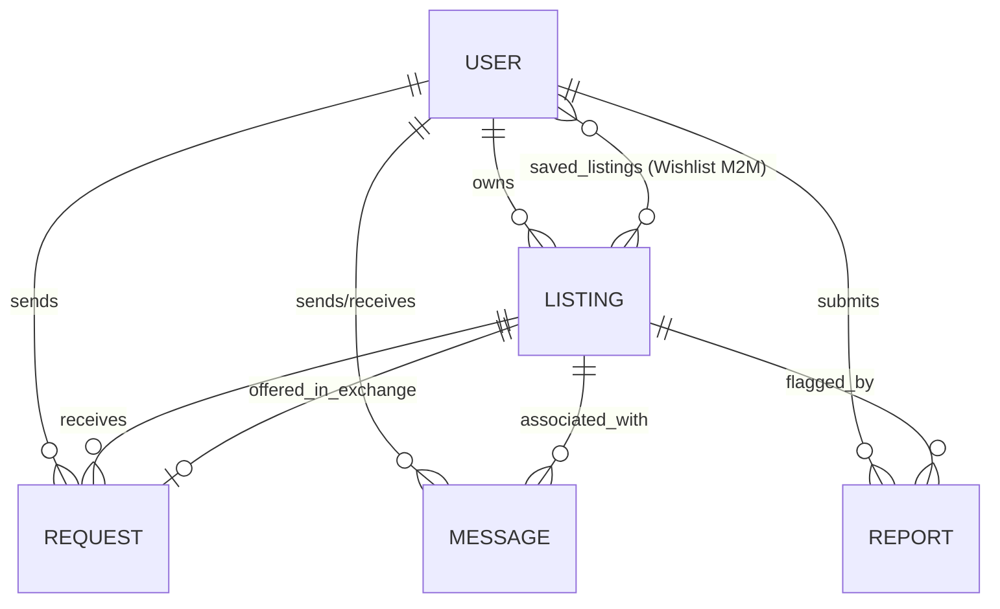
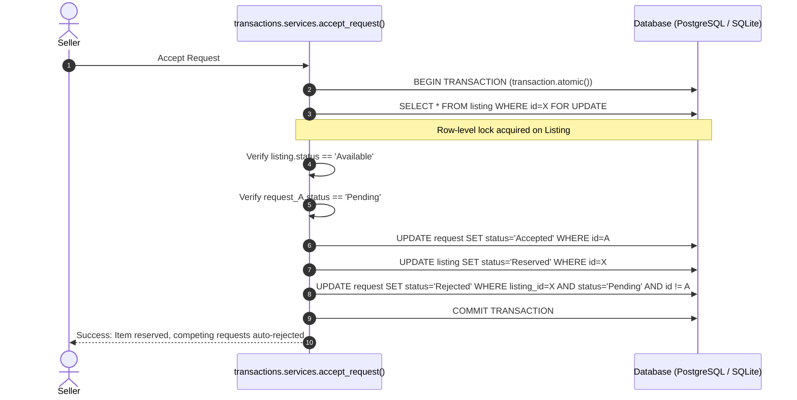

# ReFind – Architecture & Engineering Design Documentation

## 1. System Overview

**ReFind** is a campus-based, university-exclusive pre-owned goods marketplace built with Django 5, PostgreSQL, HTMX, and Tailwind CSS.
Tagline: *"Find it again. Give it a new beginning."*

Unlike traditional e-commerce platforms, ReFind operates on a **localized, circular, in-person campus handover model**. There are no online payment gateways or delivery couriers in the MVP; verified students interact, negotiate, and complete handovers directly on campus grounds.

---

## 2. Technology Stack & Component Structure

- **Backend Framework**: Python 3.13 / Django 5 (MVT Architecture)
- **Business Logic Layer**: Explicit Service Layer (`transactions/services.py`, `accounts/services.py`)
- **Database**: PostgreSQL (with SQLite zero-config local development fallback)
- **Frontend / Dynamic Interactivity**: Server-rendered Django Templates + HTMX (partial DOM swaps without full-page reloads)
- **Styling**: Tailwind CSS (Natural green-and-white sustainability theme: `#218C50`, `#176B3A`, `#E8F5E9`, `#F8FAF7`)
- **Icons**: Lucide Icons
- **Image & File Handling**: Pillow, Django File Storage with Cloudinary production support

---

## 3. Database Schema & Data Dictionary

ReFind implements 5 primary models and 1 join table:

### 3.1 Model Specifications

1. **User (`accounts.User`)**:
   - `id`: BigAutoField, Primary Key
   - `email`: EmailField(unique=True, db_index=True) - `USERNAME_FIELD`
   - `full_name`: CharField(max_length=150)
   - `phone`: CharField(max_length=20, blank=True)
   - `hostel`: CharField(max_length=100, blank=True)
   - `avatar`: ImageField(upload_to='avatars/', blank=True, null=True)
   - `role`: CharField(choices=['student', 'admin'], default='student')
   - `is_email_verified`: BooleanField(default=False)
   - `saved_listings`: ManyToManyField(Listing, related_name='saved_by', blank=True)

2. **Listing (`listings.Listing`)**:
   - `id`: BigAutoField, Primary Key
   - `owner`: ForeignKey(User, on_delete=CASCADE, related_name='listings')
   - `title`: CharField(max_length=200, db_index=True)
   - `description`: TextField()
   - `category`: CharField(choices=['Books', 'Electronics', 'Furniture', 'Cycles', 'Sports', 'Hostel Essentials', 'Other'], db_index=True)
   - `condition`: CharField(choices=['New', 'Like New', 'Good', 'Fair'], db_index=True)
   - `listing_type`: CharField(choices=['Sell', 'Exchange', 'Donate'], db_index=True)
   - `price`: DecimalField(max_digits=10, decimal_places=2, default=0.00, blank=True, null=True)
   - `wanted_item_text`: TextField(blank=True)
   - `status`: CharField(choices=['Available', 'Reserved', 'Sold', 'Exchanged', 'Donated', 'Inactive'], default='Available', db_index=True)
   - `image`: ImageField(upload_to='listings/')
   - `image2`: ImageField(upload_to='listings/', blank=True, null=True)
   - `image3`: ImageField(upload_to='listings/', blank=True, null=True)
   - `created_at`: DateTimeField(auto_now_add=True, db_index=True)
   - `updated_at`: DateTimeField(auto_now=True)

3. **Request (`transactions.Request`)**:
   - `id`: BigAutoField, Primary Key
   - `listing`: ForeignKey(Listing, on_delete=CASCADE, related_name='requests')
   - `requester`: ForeignKey(User, on_delete=CASCADE, related_name='sent_requests')
   - `offered_listing`: ForeignKey(Listing, null=True, blank=True, on_delete=SET_NULL, related_name='exchange_offers')
   - `message`: TextField(blank=True)
   - `status`: CharField(choices=['Pending', 'Accepted', 'Rejected', 'Cancelled', 'Completed'], default='Pending', db_index=True)
   - `rating`: PositiveSmallIntegerField(null=True, blank=True, validators=[1..5])
   - `review_text`: TextField(blank=True)
   - `created_at`: DateTimeField(auto_now_add=True, db_index=True)
   - `updated_at`: DateTimeField(auto_now=True)

4. **Message (`messaging.Message`)**:
   - `id`: BigAutoField, Primary Key
   - `listing`: ForeignKey(Listing, on_delete=CASCADE, related_name='messages')
   - `sender`: ForeignKey(User, on_delete=CASCADE, related_name='sent_messages')
   - `recipient`: ForeignKey(User, on_delete=CASCADE, related_name='received_messages')
   - `body`: TextField()
   - `sent_at`: DateTimeField(auto_now_add=True, db_index=True)
   - `is_read`: BooleanField(default=False, db_index=True)

5. **Report (`transactions.Report`)**:
   - `id`: BigAutoField, Primary Key
   - `reporter`: ForeignKey(User, on_delete=CASCADE, related_name='submitted_reports')
   - `listing`: ForeignKey(Listing, on_delete=CASCADE, related_name='reports')
   - `reason`: TextField()
   - `status`: CharField(choices=['Open', 'Resolved', 'Dismissed'], default='Open', db_index=True)
   - `created_at`: DateTimeField(auto_now_add=True, db_index=True)

---

## 4. Critical Concurrency Protection & Transaction Lifecycle

A central architectural mandate of ReFind is **Double Acceptance Prevention**.
When multiple students submit competing requests for an available listing:

### Completion & Handover Lifecycle
1. Once physical handover occurs on campus, the seller triggers **Complete Handover**.
2. Listing status transitions to `Sold` (if type is Sell), `Exchanged` (if type is Exchange), or `Donated` (if type is Donate).
3. Request status transitions to `Completed`.
4. The requester is unlocked to submit a 1–5 star rating and peer review.
5. The seller's aggregate reputation score (`average_rating`) recalculates automatically.

---

## 5. HTMX Dynamic Component Integration

- **Wishlist Toggle**: `hx-post="/listings/<id>/wishlist-toggle/"` swaps the heart icon and triggers custom event `wishlistUpdated` to refresh the navbar counter in real time.
- **Marketplace Filters**: `hx-get="/listings/"` with `hx-target="#product-grid-container"` performs partial DOM swaps of the product grid without page reload.
- **Messenger Live Updates**: `hx-get="/messages/thread/<listing_id>/<user_id>/poll/"` with `hx-trigger="every 5s"` automatically retrieves new incoming messages and scrolls smoothly to bottom.
